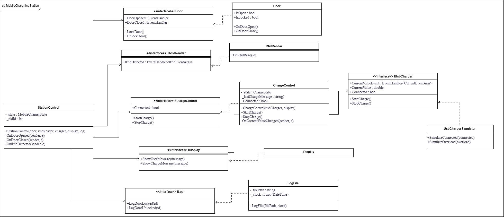
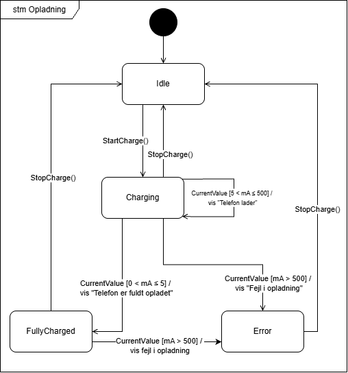
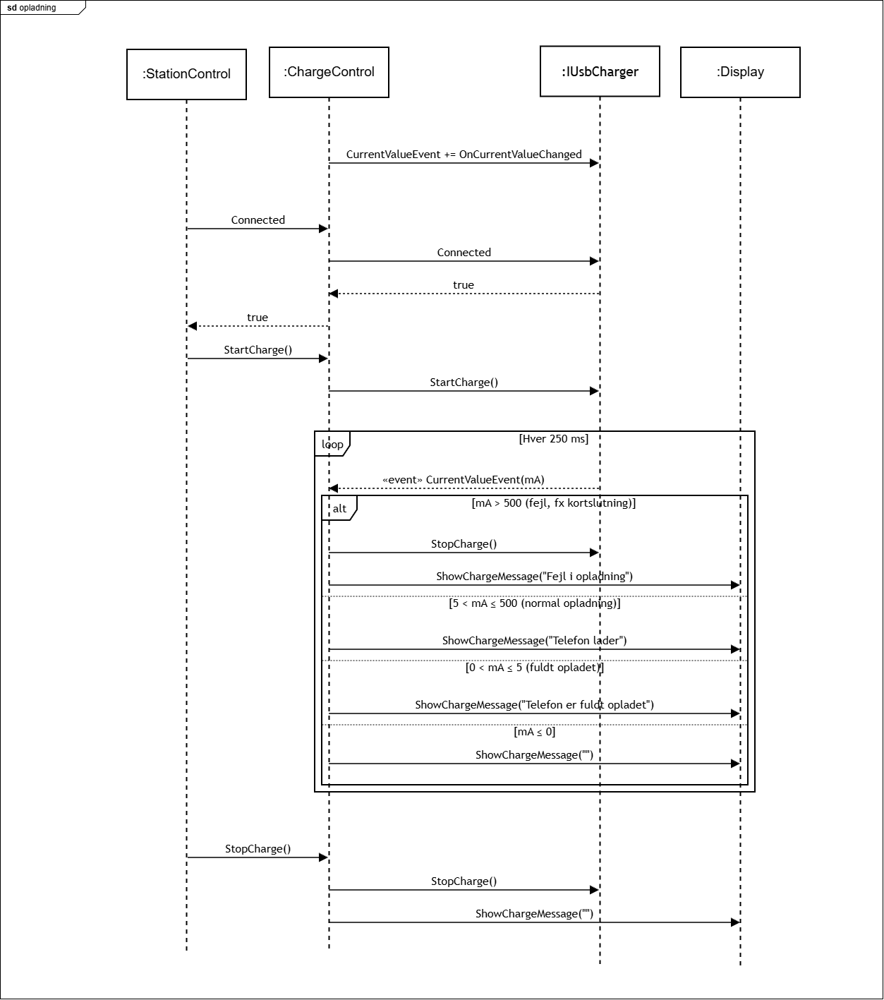

# Ladeskab til mobiltelefoner, design, test og refleksion

**Gruppe 50, SW4SWT, Hand-in 2**

Dette dokument beskriver designet og implementeringen af software til et ladeskab til mobiltelefoner, hvordan løsningen er testet, og hvordan vi har arbejdet sammen gennem et fælles repository med continuous integration. Til sidst reflekterer vi over vores valg og over samarbejdet.

## Indhold
1. [Introduktion](#1-introduktion)
2. [Design](#2-design)
3. [Refleksion over designet](#3-refleksion-over-designet)
4. [Teststrategi](#4-teststrategi)
5. [Continuous integration](#5-continuous-integration)
6. [Arbejdsfordeling](#6-arbejdsfordeling)
7. [Refleksion over fælles repository og CI](#7-refleksion-over-fælles-repository-og-ci)
8. [Konklusion](#8-konklusion)


## 1. Introduktion

Løsningen består af tre projekter i én solution:

- **`MobileChargingStation.Lib`**, klassebiblioteket med al funktionalitet, opdelt i `Boundary` og `Control`.
- **`MobileChargingStation.Lib.Test`**, NUnit-tests af klassebiblioteket.
- **`MobileChargingStation.ConsoleApp`**, en konsolapplikation, der samler systemet og lader brugeren styre et forløb fra tastaturet.

## 2. Design

### 2.1 Arkitektur

Klassebiblioteket er delt i to lag:

- **Boundary-laget** repræsenterer omverdenen: `Door`, `RfidReader`, `Display` og `LogFile`, samt den udleverede `UsbChargerSimulator`. Disse klasser er systemets eneste kontakt til hardware, konsol, filsystem og tid.
- **Control-laget** indeholder logikken: `StationControl` styrer selve skabet (dør, RFID, låsning og logning), og `ChargeControl` styrer opladningen ud fra den målte strøm.

Lagene er forbundet udelukkende gennem interfaces. Controllerne kender aldrig de konkrete boundary-klasser; alle afhængigheder gives ind gennem constructoren. Kun konsolapplikationen kender de konkrete klasser og sætter systemet sammen. Kommunikation fra omverdenen ind i systemet sker med C#-events (observer pattern), mens controllerne styrer omverdenen med almindelige metodekald.

### 2.2 Klassediagram



*Figur 1: Klassediagram for hele systemet. Pile fra controllerne peger kun på interfaces.*

Diagrammet viser den centrale egenskab ved designet: alle pile fra `StationControl` og `ChargeControl` ender i et interface. Hver controller kan derfor oprettes i en test med fakes af alle sine afhængigheder. `StationControl` kender opladningen udelukkende gennem `IChargeControl`, så de to controllere kan også testes uafhængigt af hinanden.

`IUsbCharger` og `CurrentEventArgs` er brugt uændret, som opgaven kræver. De øvrige interfaces har vi selv defineret. `RfidEventArgs` er lagt ved siden af `IRfidReader` efter samme mønster som `CurrentEventArgs`.

### 2.3 Et testbart design

Vi har indkapslet afhængighederne i tre trin:

1. **Identificér afhængighederne.** Ud over hardwaren (dør, RFID-læser og USB-lader) har systemet tre "usynlige" afhængigheder, som ikke kan styres i en test: konsollen, filsystemet og tiden. Den udleverede kode til `StationControl` skrev direkte til `Console`, åbnede filen med `File.AppendText` og brugte `DateTime.Now`, og kunne derfor ikke unittestes.
2. **Læg et interface ind.** Hver afhængighed er lagt bag et interface: `IDoor`, `IRfidReader`, `IUsbCharger`, `IDisplay` (konsollen) og `ILog` (filsystemet). Tiden indkapsles i `LogFile`, som er den eneste klasse, der skriver tidspunkter.
3. **Dependency injection.** Alle afhængigheder gives ind gennem constructoren (constructor injection). Ingen af controllerne opretter selv deres afhængigheder med `new`.

I testene erstattes afhængighederne af fakes fra NSubstitute, og i konsolapplikationen gives de rigtige klasser ind. Selve controllerne er de samme i begge tilfælde.

Boundary-klasserne har ingen afhængigheder ud over de ressourcer, de selv indkapsler. `LogFile` får både filstien og tidskilden ind gennem constructoren (`Func<DateTime>`), så den kan testes mod en midlertidig fil med et fast tidspunkt. Standardværdierne (`"logfile.txt"` og `DateTime.Now`) bruges i konsolapplikationen.

### 2.4 Tilstandsdiagram for opladningen



*Figur 2: Tilstandsdiagram for opladningen.*

Figur 2 viser tilstandsmaskinen i `ChargeControl`. Den har fire tilstande: `Idle`, `Charging`, `FullyCharged` og `Error`.

`ChargeControl` starter i `Idle`. Når `StartCharge()` kaldes, skifter den til `Charging`, og `StopCharge()` fører tilbage til `Idle`.

I `Charging` bliver hver ny strømmåling (`CurrentValue`) vurderet. Ligger strømmen over 5 mA og højst 500 mA, bliver `ChargeControl` i `Charging` og viser "Telefon lader". Ligger den over 0 mA og højst 5 mA, er telefonen fuldt opladet: der vises "Telefon er fuldt opladet", og tilstanden skifter til `FullyCharged`. Er strømmen over 500 mA, er der en fejl: der vises "Fejl i opladning", og tilstanden skifter til `Error`.

Fra `FullyCharged` fører en strøm over 500 mA også til `Error` med beskeden "Fejl i opladning". Fra både `FullyCharged` og `Error` fører `StopCharge()` tilbage til `Idle`, så skabet er klar til en ny opladning.

### 2.5 Sekvensdiagram for opladningen



*Figur 3: Sekvensdiagram for opladningen.*

Figur 3 viser, hvordan opladningen forløber mellem `StationControl`, `ChargeControl`, USB-laderen og displayet.

Først abonnerer `ChargeControl` på USB-laderens `CurrentValueEvent`. Det sker i constructoren og er det, der binder de to sammen med observer pattern. Når brugeren holder sit RFID-tag op, spørger `StationControl` om en telefon er tilsluttet. `ChargeControl` sender blot spørgsmålet videre til USB-laderen og returnerer svaret. Er telefonen tilsluttet, kalder `StationControl` `StartCharge()`, og `ChargeControl` starter USB-laderen.

Derefter sender USB-laderen en ny strømmåling med jævne mellemrum, og `ChargeControl` vælger, hvad der skal ske, ud fra strømmen. Over 500 mA stoppes USB-laderen med det samme, og der vises "Fejl i opladning". Mellem 5 og 500 mA vises "Telefon lader", mellem 0 og 5 mA vises "Telefon er fuldt opladet", og ved 0 mA eller derunder ryddes ladeområdet.

Når brugeren låser skabet op, kalder `StationControl` `StopCharge()`. `ChargeControl` stopper USB-laderen og rydder ladeområdet.


### 2.6 Boundary-klasserne

**`Door`** holder styr på, om døren er åben og låst. `OnDoorOpen()` og `OnDoorClose()` simulerer, at brugeren åbner og lukker lågen. Døren opfører sig som en fysisk dør: en låst dør kan ikke åbnes, og en åben dør kan ikke låses. Events rejses kun, når dørens tilstand faktisk ændrer sig.

**`RfidReader`** rejser `RfidDetected` med det læste id, når `OnRfidRead(id)` kaldes. Den validerer ikke id'et; det er `StationControl`, der afgør, om et id er det rigtige.

**`Display`** har én metode pr. displayområde og skriver beskeden til konsollen med præfikset `[Bruger]` eller `[Ladning]`. Klassen indeholder ingen logik om, hvad der skal vises.

**`LogFile`** tilføjer én linje pr. hændelse i formatet `14:03:22: Skab låst med RFID: 42`. Tidspunktet formateres med invariant culture, så formatet er det samme uanset maskinens sprogindstillinger.

### 2.7 Konsolapplikationen

`Program.cs` opretter boundary-objekterne, giver USB-simulatoren og displayet til `ChargeControl` og giver det hele til `StationControl`. Brugeren styrer forløbet med tasterne **O** og **C** (åbn og luk døren), **R** (læs et RFID-tag) og **E** (afslut). Vi har tilføjet **T**, der tilslutter eller frakobler telefonen, og **K**, der slår en kortslutning til og fra, så også tilslutningsfejl og fejl under opladning kan demonstreres. Et RFID-id, der ikke er et tal, afvises med en besked.

---

## 3. Refleksion over designet

### 3.1 Interfaces og dependency injection

Det har været et vigtigt valg i projektet at lade controllerne afhænge af interfaces og få dem ind gennem constructoren. Fordelen er tydelig i testene: hver controller kan oprettes med fakes af alle afhængigheder, og en fejlende test peger direkte på den klasse, der testes, i stedet for på en af dens afhængigheder. Interfaces gjorde det også muligt at arbejde parallelt, fordi hver person kunne programmere og teste mod de andres interfaces, før implementeringerne fandtes.


### 3.2 Observer pattern med C#-events

Vores første klassediagram for opladningen indeholdt en observer-løsning med `Attach`, `Detach` og et `ICurrentObserver`-interface. Vi droppede den, fordi opgaven kræver, at `IUsbCharger` bruges uændret, og fordi C#-events allerede er en implementation af observer pattern. Vi har derefter brugt events konsekvent for alt, der kommer fra omverdenen: døren, RFID-læseren og USB-laderen. Det giver løs kobling, afsenderen ved ikke, hvem der lytter, og events er nemme at rejse fra en fake i en test.


### 3.3 Enum frem for state pattern

Begge controllere er implementeret som tilstandsmaskiner med en privat enum. Til `ChargeControl` overvejede vi state pattern med en klasse pr. tilstand, som vores første diagram også viste. Vi valgte det fra af tre grunde. For det første er over halvdelen af kombinationerne af tilstand og input "gør ingenting", så de fleste metoder i state-klasserne ville være tomme. For det andet skulle state-klasserne kende den konkrete `ChargeControl` for at kunne skifte tilstand, og `ChargeControl` skulle kende dem, og den gensidige afhængighed ville gøre klasserne sværere at teste hver for sig. For det tredje bruger `StationControl` en enum, og med samme løsning i begge controllere er koden ens at læse.


### 3.4 Opladningen stoppes ikke ved fuldt opladet

Ifølge opgaven kan opladningen stoppes, når strømmen er 5 mA eller derunder, mens den skal stoppes over 500 mA. Vi har valgt ikke at stoppe ved fuldt opladet. Når USB-laderen stoppes, sender den straks en måling på 0 mA, og den måling ville rydde beskeden "Telefon er fuldt opladet", inden brugeren kommer tilbage. Ved at lade laderen køre forbliver strømmen lav, og beskeden står på displayet, indtil skabet låses op. Konsekvensen er, at `ChargeControl` også skal håndtere overbelastning i tilstanden `FullyCharged`, fordi en kortslutning skal stoppes uanset tilstand.

Den samme 0 mA-måling skabte et andet problem. Fordi events er synkrone, modtager `ChargeControl` målingen, mens dens eget kald til `usb.StopCharge()` stadig kører. Var tilstanden stadig `Charging` på det tidspunkt, ville målingen blive tolket, som om brugeren havde trukket kablet ud. Derfor skifter `ChargeControl` altid tilstand, før den stopper USB-laderen. 

### 3.5 Samme ladebesked vises kun én gang

USB-laderen sender en ny måling fire gange i sekundet. Vores første version af `ChargeControl` sendte "Telefon lader" ved hver måling, hvilket var korrekt ifølge unittestene, men i konsolapplikationen skriver `Display` hver besked på en ny linje, så skærmen blev fyldt med ens linjer. Problemet viste sig først, da alle delene blev sat sammen. Vi løste det ved, at `ChargeControl` husker den sidst viste besked og kun sender en ny, når teksten ændrer sig. Løsningen ligger i `ChargeControl` og ikke i `Display`, fordi det er `ChargeControl`, der bestemmer, hvad der skal vises, mens `Display` holdes simpel. 

---

## 4. Teststrategi

### 4.1 Principper

Alle tests er skrevet med NUnit og følger mønstret arrange-act-assert. Hver test får en ny instans af den testede klasse (UUT) og nye fakes i `[SetUp]`, så testene er uafhængige og kan køres i vilkårlig rækkefølge. Testnavnene følger mønstret `Metode_Scenarie_ForventetResultat`, fx `Rfid_LockedAndWrongId_ShowsRfidError` og `CurrentEvent_ChargingOverload_StopsUsbCharger`.

Testene er black box. De bruger kun klassernes offentlige metoder, properties og events eller det output, klasserne producerer, og ser aldrig på private felter som tilstandsvariablen. Det betyder, at testene beskriver de krav, klasserne skal opfylde, og ikke implementeringen, så de ikke går i stykker, når koden refaktoreres. 

### 4.2 Controllere testes med fakes

`StationControl` og `ChargeControl` testes med fakes fra NSubstitute af alle deres afhængigheder. De fleste tests er interaktionsbaserede: testen udløser en hændelse og kontrollerer bagefter, at UUT'en har kaldt de rigtige metoder på sine fakes. Her bruges fake'en som mock, og der asserts med `Received` og `DidNotReceive`. Et eksempel fra `StationControlTest`:

```csharp
[Test]
public void Rfid_AvailableAndConnected_LocksAndStartsCharging()
{
    _charger.Connected.Returns(true);

    ScanRfid(42);   // rejser RfidDetected på fake'en af IRfidReader

    _door.Received(1).LockDoor();
    _charger.Received(1).StartCharge();
    _log.Received(1).LogDoorLocked(42);
    _display.Received(1).ShowUserMessage("Ladeskab optaget");
}
```

Her er `_charger` samtidig en stub, fordi den leverer værdien af `Connected`. Testen af `ChargeControl.Connected` er derimod tilstandsbaseret: fake'en sættes til at returnere en værdi, og der asserts på det, UUT'en selv returnerer.

Events fra omverdenen simuleres ved at lade fake'en rejse dem med `Raise.Event()` eller `Raise.EventWith(...)`. I `ChargeControlTest` er det samlet i en hjælpemetode, så en strømmåling kan sendes med `RaiseCurrent(250)`. Testene kommer ind i tilstandene `FullyCharged` og `Error` ved at sende de målinger, der fører dertil, og kontrollerer derefter opførslen i tilstanden.

### 4.3 Boundary-klasser testes direkte

Boundary-klasserne har ingen afhængigheder, der skal fakes, så de testes direkte på deres tilstand og output:

- **`Door` og `RfidReader`** testes ved at abonnere på deres events med en lambda, der tæller kald og gemmer argumenter, og ved at aflæse properties som `IsOpen` og `IsLocked`.
- **`Display`** testes ved at omdirigere konsollens output til en `StringWriter` med `Console.SetOut` og kontrollere den skrevne tekst. Det oprindelige output gendannes i `[TearDown]`.
- **`LogFile`** testes mod en rigtig, midlertidig fil med et unikt navn, som slettes efter hver test, og med en fast tidskilde, så indholdet kan kontrolleres præcist. Det er bevidst, at denne test rører filsystemet: `LogFile` er den eneste klasse, der gør det, og alle andre klasser testes mod en fake `ILog`.

### 4.4 Valg af testcases

Testcases er valgt systematisk med ækvivalensklasser (EP), grænseværdianalyse (BVA) og ZOMBIE.

**Strømmen i ChargeControl** er det sted i opgaven, hvor grænserne er vigtigst. Strømtabellen deler input i fem ækvivalensklasser: negativ (ugyldig), 0 mA, over 0 til og med 5 mA, over 5 til og med 500 mA og over 500 mA. Hver grænse er testet på grænsen og på begge sider. Da strømmen er et kommatal, bruger vi 0,01 mA som skridt:

| Grænse | Lige under | På grænsen | Lige over |
|---|---|---|---|
| 0 mA | -1 → ryd | 0 → ryd | 0,01 → fuldt opladet |
| 5 mA | 4,99 → fuldt opladet | 5 → fuldt opladet | 5,01 → lader |
| 500 mA | 499,99 → lader | 500 → lader | 500,01 → fejl |

Derudover testes en værdi i midten af hver klasse (2,5, 250 og 750 mA). Testene er skrevet med `[TestCase]`, så den samme test køres for alle værdier i en klasse.

**Andre grænser.** I `StationControl` testes et forkert RFID med værdierne 41, 43 og 0 omkring det gemte id 42. I `LogFile` testes tidsformatet med døgnets første og sidste sekund (00:00:00 og 23:59:59) og med 09:05:07, som afslører manglende foranstillede nuller. RFID-id'er testes i `RfidReader` og `LogFile` med ekstremværdier fra `int.MinValue` til `int.MaxValue`; her er der reelt kun én ækvivalensklasse, og formålet er at vise, at id'et sendes uændret igennem.

**ZOMBIE** er brugt som tjekliste for hver klasse:

- *Zero:* en nyoprettet klasse, før noget er sket, fx at døren starter lukket og ulåst, at `StationControl` viser "Indlæs RFID" ved opstart, og at `ChargeControl` ignorerer målinger i `Idle`.
- *One:* hver transition og hver metode én gang.
- *Many:* gentagelser, døren åbnet og lukket 2, 5 og 100 gange, 100 linjer i loggen, to ens strømmålinger i træk og genlåsning af skabet med et nyt id efter oplåsning.
- *Boundaries:* grænseværdierne ovenfor.
- *Interfaces:* alle metoder og events på hver klasse og alle afhængigheder, controllerne bruger.
- *Exceptional:* robusthed, at åbne en låst dør, at låse en åben dør, negativ strøm, overbelastning i både `Charging` og `FullyCharged`, kald i forkert rækkefølge, events uden abonnenter og en ugyldig filsti til loggen.

For hver tilstand i både `StationControl` og `ChargeControl` er der også tests af, at hændelser, der skal ignoreres, faktisk ignoreres.

### 4.5 Stærke negative tests

En test skal kunne fejle, hvis koden er forkert. En af vores tidlige tests kontrollerede, at `ChargeControl` i tilstanden `Error` ikke viste "Telefon lader" igen. Men en kontrol af, at en metode ikke er kaldt med et bestemt argument, består også, hvis metoden er kaldt med et andet argument, som den heller ikke burde.

```csharp
_uut.StartCharge();
RaiseCurrent(750);                 // ind i Error
_display.ClearReceivedCalls();

RaiseCurrent(250);

_display.DidNotReceiveWithAnyArgs().ShowChargeMessage(default!);
```

Samme teknik bruges i `StationControlTest`, så kald fra constructoren eller fra en tidligere låsning ikke tæller med.

### 4.6 Coverage

| Klasse | Line coverage | Branch coverage |
|---|---|---|
| `StationControl` | 100 % | 100 % |
| `ChargeControl` | 100 % | 100 % |
| `Door` | 100 % | 100 % |
| `RfidReader` | 100 % | 100 % |
| `Display` | 100 % | 100 % |
| `LogFile` | 100 % | 100 % |
| **Klassebiblioteket samlet** | **100 %** | **100 %** |

Vi har målt både line og branch coverage, fordi line coverage alene ikke viser, om en betingelse er testet både sand og falsk. Coverage er brugt som kontrol og ikke som mål i sig selv: testcases er valgt ud fra tilstandsmaskinerne, EP, BVA og ZOMBIE først, og coverage-rapporten er bagefter brugt til at finde kode, vi havde glemt at teste. Det var fx sådan, standardtidskilden i `LogFile` fik sin egen test. Omvendt har flere tests ingen betydning for coverage, men kontrollerer opførsel, som koden skal have, fx at `ChargeControl` kan lade igen efter en fejl. 100 % coverage betyder altså, at al kode er kørt, ikke at alt er testet.


---

## 5. Continuous integration

Repositoryet har én GitLab-pipeline, defineret i `.gitlab-ci.yml`, som kører ved hvert push. Pipelinen bruger .NET 10 SDK-imaget og udfører følgende trin:

1. `dotnet build` bygger hele solutionen.
2. `dotnet test` kører alle tests og indsamler coverage med coverlet (`XPlat Code Coverage`). Testresultaterne skrives i JUnit-format.

---

## 6. Arbejdsfordeling

### 6.1 Sådan fordelte vi arbejdet

- person 1 lavede interfaces for døren, RFID-læseren, displayet og loggen, `StationControl` med tests, det første sekvensdiagram for opladningen og CI-opsætningen.
- person 2 lavede `ChargeControl` med tests og konsolapplikationen, der samler systemet.
- person 3 lavede boundary-klasserne `Door`, `RfidReader`, `Display` og `LogFile` med tests.

Det første, vi gjorde, var at blive enige om og merge alle interfaces. De fungerede som kontrakter mellem delene, så hver person derefter kunne arbejde på sin egen feature-branch og teste mod fakes af de andres klasser uden at vente på dem. 


### 6.2 Refleksion

Fordelingen efter klasser passede godt til et design med interfaces. Fordi arbejdsfordelingen lå fast tidligt, kunne vi arbejde parallelt, og hver person kunne gå i dybden med sin del

Ulempen var, at ingen havde det fulde overblik, før delene blev sat sammen. Problemet med gentagne ladebeskeder opstod netop i grænsefladen mellem to personers klasser: begge klasser var korrekte hver for sig, men sammen gav de et ubrugeligt output. Det samme gælder vores første diagrammer, som blev tegnet, før koden blev skrevet, og som derefter løb fra implementeringen, fordi beslutningerne blev truffet undervejs i hver persons del. Vi måtte derfor bruge tid til sidst på at samle overblikket og rette diagrammerne.

Hvis vi skulle gøre det igen, ville vi samle systemet i konsolapplikationen tidligere, gerne så snart de første versioner af klasserne fandtes, så fejl i samspillet blev fundet tidligt. Vi ville også aftale fra starten, at diagrammerne opdateres i samme merge request som den kode, de beskriver.

---

## 7. Refleksion over fælles repository og CI

### 7.1 Arbejdsgang

Vi arbejdede med én branch pr. opgave, fx `feature/interfaces`, `feature/chargecontrol`, `feature/stationcontrol` og `feature/boundary`, og mergede til `main` gennem merge requests. En `dev`-branch blev oprettet tidligt, men vi fandt, at den kun gav ekstra merges uden gevinst i en gruppe på tre, og arbejdede derfor direkte mod `main`.

### 7.2 Observationer

**Pipelinen var en sikkerhed, når det lokale miljø svigtede.** På én af vores maskiner blokerede Windows Smart App Control af og til den nybyggede test-DLL, så `dotnet test` fejlede lokalt, selv om der ikke var noget galt med koden. Her var pipelinen den sikre måde at se, om testene bestod.

**Infrastrukturen var ikke altid stabil.** GitLab-runneren var periodevis utilgængelig, så nogle pipelines hang uden at blive kørt. Vi slog derfor kravet om en grøn pipeline før merge fra, så en hængende pipeline ikke blokerede arbejdet. Det svækkede sikkerheden ved CI, fordi kode i princippet kunne merges uden at være testet på serveren, og vi kompenserede ved at køre alle tests lokalt før merge.

**Merge requests uden squash** gav en detaljeret historik, men også en lidt rodet graf med mange merge-commits. Til gengæld var det let at se, hvornår hver del kom ind, og hvem der havde lavet hvad.

### 7.3 Fordele og ulemper

Det fælles repository og CI gav os en fælles sandhed: `main` byggede og bestod testene, og alle kunne se testresultater og coverage for hver ændring. Det gjorde det trygt at merge andres arbejde og gav hurtig feedback, når noget gik i stykker. Små commits gjorde det let at følge med i hinandens arbejde.

Ulemperne var primært, at CI kun fanger det, testene tester, den fangede ikke fejlen i samspillet mellem `ChargeControl` og `Display`, fordi vi ikke havde tests af det samlede system, og at vi var afhængige af en runner, vi ikke selv kontrollerede. Med mere tid ville vi tilføje en simpel integrationstest af `StationControl` og `ChargeControl` sammen og gøre en grøn pipeline til et krav før merge igen, så snart runneren var stabil.

---

## 8. Konklusion

Vi har designet, implementeret og testet et ladeskab, hvor al hardware og alle afhængigheder er indkapslet bag interfaces og givet ind gennem constructoren. Det har gjort det muligt at teste hver klasse isoleret: controllerne med fakes og boundary-klasserne direkte. Testcases er valgt med EP, BVA og ZOMBIE, og klassebiblioteket har 100 % line- og branch-coverage. De vigtigste designbeslutninger, at bruge events og enums, at lade opladningen fortsætte ved fuldt opladet og at begrænse gentagne beskeder, er truffet for at holde koden enkel og testbar.
